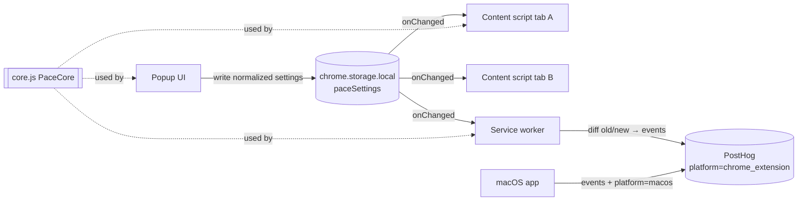

# feat: Pace for Chrome — lightweight rectangle focus overlay extension

## Summary

Bring Pace's core reading aid — a dimmed screen with a horizontal focus band that follows the mouse — to Chrome as a Manifest V3 extension living in `browser-extension/` in this repo. v1 ships only the Rectangle mode in three sizes, with the same display controls as the Mac app (dark/light, opacity, blur), global on/off that applies across all tabs, and PostHog analytics tagged with a `platform` property so Mac and browser usage can be told apart. No build step, no runtime libraries; Playwright + `node:test` are dev-only.

---

## Problem Frame

Pace today is a macOS menu-bar app (`pace/paceApp.swift`, `pace/ContentView.swift`, `pace/FocusShape.swift`). A lot of reading happens in the browser, and a browser extension reaches users who won't install a native app (non-Mac, managed machines). The extension should feel like the Mac app's Rectangle mode, stay tiny, and not degrade the pages it runs on.

---

## Requirements

- **R1.** Chrome MV3 extension in `browser-extension/` (monorepo alongside the Swift app). Chrome only for v1.
- **R2.** Rectangle mode only: a full-viewport-width transparent band centered on the mouse's Y position; everything above and below is dimmed. Mirrors `RectangleShape` in `pace/FocusShape.swift` (band follows mouse vertically only).
- **R3.** Three sizes S / M / L with band heights 200 / 300 / 450 CSS px (base 200 × multipliers 1.0 / 1.5 / 2.25 from `FocusSize`). Default M.
- **R4.** Display controls matching `FocusConfiguration`: dark/light (default dark), opacity 10–100% (default 70%), blur 0–20px (default 0).
- **R5.** Global on/off: when enabled, the overlay appears on every open and newly opened regular web page tab; changes in the popup apply live to all tabs. Settings persist across browser restarts.
- **R6.** The page underneath stays fully usable (clicks, scroll, selection, typing pass through).
- **R7.** Lightweight: no build step, no runtime dependencies, minimal permissions, negligible idle cost when disabled.
- **R8.** Analytics: send the Mac app's core events to the same PostHog project with `platform: "chrome_extension"`; tag Mac events with `platform: "macos"` so dashboards can break down by platform.
- **R9.** Popup indicates when the current tab can't show the overlay (`chrome://`, Web Store, etc.).
- **R10.** Automated unit + end-to-end tests that a subagent can run headlessly, plus a manual QA checklist for a subagent driving real Chrome.

---

## Scope Boundaries

- Not included: Center Column, Square, Circle modes; Focus Message; Flash/Pomodoro; side panel; onboarding; auto-updates; keyboard shortcuts (`commands`); Firefox/Safari/Edge packaging.
- No sending of URLs, page titles, or page content in analytics.
- No overlay inside iframes (top frame only).

### Deferred to Follow-Up Work

- Chrome Web Store listing and privacy policy page.
- Other shapes (reusing the same panel architecture), other browsers.
- Packaging script (zip) and release automation.

---

## Context & Research

### Relevant Code and Patterns

- `pace/FocusShape.swift` — `FocusSize` multipliers, `FocusConfiguration` defaults and keys (`PaceFocusSize`, `PaceFocusOpacity`, `PaceFocusBlurRadius`, `PaceFocusIsDarkMode`), `baseRectangleHeight = 200`, `RectangleShape` geometry (`y - height/2`, full width).
- `pace/ContentView.swift` — `OverlayContentView`: dimming fill with `destinationOut` cutout; blur via `VisualEffectView` behind the fill; 0.15s ease-out on mouse movement and 0.3s on setting changes; `allowsHitTesting(false)`. `GlobalMouseTracker` skips updates under 0.5px.
- `pace/paceApp.swift` — `applyFocusSize`, `applyOpacity`, `applyBlurRadius`, `applyDarkMode`: each change persists immediately and shows the overlay if hidden. The extension popup copies this behavior: changing a setting while off turns the overlay on.
- `pace/AnalyticsManager.swift` — event names and properties (`app_opened{is_new_user}`, `pace_view_shown`, `pace_view_hidden{view_duration_seconds}`, `mode_activated{mode,size}`, `mode_deactivated{mode,duration_seconds}`), anonymous UUID distinct id, `Config.swift` key loading with empty-key no-op.
- `docs/analytics/README.md` — dashboard definitions that will gain a platform breakdown.

### Institutional Learnings

- No `docs/solutions/` exists. The repo's tests (`paceTests/`, `paceUITests/`) are gitignored stubs, so the extension brings its own test harness.

### External References (from planning knowledge; confirm during implementation)

- MV3 content scripts declared in `manifest.json` cannot use ES `import`; they share one isolated world, so several classic scripts can share a global. A classic (non-module) service worker can use `importScripts`.
- MV3 service workers can't use dynamic `import()`. Optional config is loaded with `fetch(chrome.runtime.getURL(...))`, which fails cleanly when the file is missing.
- Playwright loads unpacked extensions through `chromium.launchPersistentContext` with `--disable-extensions-except` / `--load-extension`. This works with Playwright's bundled Chromium, including headless via the `chromium` channel; branded Chrome 137+ ignores `--load-extension`. The extension ID comes from the service worker URL.
- PostHog's HTTP capture endpoint (`POST {host}/i/v0/e/` with `api_key`, `event`, `distinct_id`, `properties`) supports CORS, so no `host_permissions` should be needed.

---

## Key Technical Decisions

- **Two-panel rendering, not a mask:** the overlay is two fixed, full-width panels (above and below the band) inside an open Shadow DOM, with `pointer-events: none` and `aria-hidden="true"` on the host. An open root gives the same CSS isolation from hostile page styles, and e2e tests can reach the panels through `host.shadowRoot`. *Rationale:* blur needs `backdrop-filter`, and that only works when it sits on the dimmed elements themselves. A box-shadow or `clip-path` cutout can't blur. Two panels keep the band truly transparent.
- **Move panels with `transform` only:** each panel is full viewport height. The top panel is translated so its bottom edge sits at `y - h/2`; the bottom panel's top edge sits at `y + h/2`. Updates are batched with `requestAnimationFrame` from a passive `mousemove` listener, with a short CSS transition (about 120ms ease-out, close to the Mac app's 0.15s mouse-movement animation). All transitions are turned off under `prefers-reduced-motion: reduce`. *Rationale:* moving with `transform` doesn't force the page to recalculate layout. The band is allowed to run partly off the top or bottom of the viewport, like the Mac app.
- **Global state, static content script on `<all_urls>`:** R5 needs the overlay to show up in new tabs without a click, which rules out on-demand injection with `activeTab`. The content script is small, and while disabled it does nothing except listen for `storage.onChanged` (filtered to the settings key) and answer a popup ping. Permissions are `storage` and `scripting`. Chrome doesn't inject manifest content scripts into tabs that were already open when the extension is installed or updated, so the service worker re-injects `core.js` and `content.js` into every existing http(s) tab on `runtime.onInstalled` (reasons `install` and `update`), ignoring errors per tab. *Trade-off:* the Web Store will warn that the extension can "read and change data on all websites". That's acceptable for a reading aid.
- **Custom element host attached to `document.documentElement`:** use a uniquely named host element (e.g. `pace-focus-overlay`) with inline `!important` positioning and an open shadow root. *Rationale:* this survives hostile page CSS and `transform`/`overflow` on `<body>`. It sits at the maximum z-index and is hidden in `@media print`.
- **One settings object in `chrome.storage.local`:** stored under a single key (e.g. `paceSettings`) as `{enabled, size, opacity, blurRadius, isDarkMode}`. Every read goes through one normalizer that applies defaults and clamps values. *Rationale:* one `onChanged` event per change, and bad stored values can't break rendering. The field names mirror `FocusConfiguration`.
- **Shared classic-script core:** `src/core.js` is pure logic (defaults, normalization, size→height, panel geometry, colors, restricted-URL check, analytics diffing and payload building). It attaches to `globalThis.PaceCore` and also sets `module.exports` when that exists. The content script, popup and service worker load it as a classic script; Node unit tests `require` it. *Rationale:* no bundler, and one tested source of truth.
- **Analytics lives in the service worker and reacts to storage changes:** the worker listens to `storage.onChanged`, diffs old vs new settings, and emits events. *Rationale:* events fire once no matter which surface made the change, and storage events wake the worker. `viewShownAt` and `modeShownAt` are kept in `chrome.storage.local` so durations survive the worker going to sleep.
- **Analytics config via gitignored `browser-extension/config.json`:** holds `{posthogApiKey, posthogHost}`, with `config.example.json` committed. If the file is missing or the key is empty, analytics does nothing (same as `Config.swift`). *Rationale:* mirrors how the Mac app keeps its key out of git, without needing a build step. Only the write-only PostHog project key goes here, never a personal API key. `config.json` must never be listed in `web_accessible_resources`; the worker's own fetch doesn't need it. `posthogHost` is accepted only if it parses as an `https:` URL; otherwise analytics stays off.
- **Analytics opt-out toggle:** the popup has a "Share anonymous usage" switch, on by default and stored as `analyticsEnabled` in `chrome.storage.local`. The worker checks it before every send. *Rationale:* the content script runs on every page, and an opt-out is cheap insurance for user trust and Web Store review.
- **Analytics sessions follow browser sessions:** on `runtime.onStartup`, the worker emits `app_opened{is_new_user:false}`. If Pace is enabled, it also resets `viewShownAt` and `modeShownAt` to now and emits `pace_view_shown` + `mode_activated`. *Rationale:* `enabled` persists across restarts. Without this, durations would include time the browser was closed and long-term users would look churned, which would skew the dashboards shared with the Mac app.
- **Mac platform tag:** register `platform: "macos"` as a PostHog super property in `AnalyticsManager.configure()`. *Rationale:* both platforms then break down on the same property. PostHog's `$lib` is a fallback for older Mac builds.

---

## Open Questions

### Resolved During Planning

- Blur included (user decision). Keyboard shortcuts excluded (user decision). Monorepo layout (user decision). Analytics included with platform tagging (user decision).
- Default size for rectangle is M. The Mac app's default mode is circle/M; the extension only has rectangle, so M carries over.

### Deferred to Implementation

- The exact Playwright version: choose one whose bundled Chromium matches the locally cached build, or allow the download.
- Whether PostHog CORS works from the service worker without `host_permissions`. The routed e2e test can't answer this. Settle it with the manual real-key step in `test/QA_CHECKLIST.md` (events arrive, no CORS error in the worker console); add `https://*.posthog.com/*` to `host_permissions` only if that fails.
- Whether the chosen Playwright version routes MV3 service-worker fetches by default or needs `PW_EXPERIMENTAL_SERVICE_WORKER_NETWORK_EVENTS=1`.
- How `background.test.js` loads `background.js` in Node: likely a `vm` context with stubbed `chrome`, `fetch` and an `importScripts` shim that requires `core.js`.
- Whether `backdrop-filter` blur on full-viewport panels hurts scroll smoothness on heavy pages. Measure during manual QA; the fallback is to note it in the UI hint.

---

## Output Structure

```text
browser-extension/
├── manifest.json
├── config.example.json          # committed; config.json is gitignored
├── icons/                       # 16/32/48/128 PNGs from pace/Assets.xcassets/AppIcon.appiconset
├── src/
│   ├── core.js                  # pure shared logic (PaceCore)
│   ├── content.js               # overlay rendering + mouse tracking
│   ├── background.js            # service worker: install defaults + analytics
│   └── popup/
│       ├── popup.html
│       ├── popup.css
│       └── popup.js
├── test/
│   ├── unit/                    # node:test
│   ├── e2e/                     # Playwright specs
│   │   └── fixtures/            # test HTML pages
│   └── helpers/                 # extension launch + page routing helpers
├── package.json                 # devDependencies only
├── playwright.config.js
└── README.md
```

---

## High-Level Technical Design



Overlay geometry for mouse Y = `y`, band height `h`, viewport height `V` (directional):

```text
top panel:    height V, translateY(y - h/2 - V)   → bottom edge at y - h/2
bottom panel: height V, translateY(y + h/2)       → top edge at y + h/2
band:         [y - h/2, y + h/2] is untouched page
initial y:    V/2 until the first mousemove
```

Analytics diff rules (old → new settings), evaluated in the service worker:

| Change | Events |
|---|---|
| enabled false → true | `pace_view_shown`, `mode_activated{mode:"rectangle", size}` |
| enabled true → false | `pace_view_hidden{view_duration_seconds}`, `mode_deactivated{mode:"rectangle", duration_seconds}` |
| size changes while enabled | `mode_deactivated` (old size duration) then `mode_activated{size: new}` |
| opacity / blur / dark changes | none (matches Mac app) |
| install (`runtime.onInstalled` reason `install`) | `app_opened{is_new_user: true}` |
| browser start (`runtime.onStartup`) | `app_opened{is_new_user: false}`; if enabled, also reset timestamps and emit `pace_view_shown` + `mode_activated` |
| popup opened (validated runtime message) | `popup_opened` |
| `analyticsEnabled` is false | nothing is sent |

Every event carries `platform: "chrome_extension"`, `extension_version`, `browser: "chrome"`, plus an anonymous UUID `distinct_id` that persists in storage.

---

## Implementation Units

### U1. Scaffold extension, manifest, icons, and test harness

**Goal:** A loadable empty-but-valid MV3 extension and working test runners.

**Requirements:** R1, R7, R10

**Dependencies:** none

**Files:**
- Create: `browser-extension/manifest.json`, `browser-extension/package.json`, `browser-extension/playwright.config.js`, `browser-extension/config.example.json`, `browser-extension/icons/*.png`
- Create: `browser-extension/test/helpers/launch.js` (launch persistent context with extension, resolve extension ID from the service worker, open popup page, route `https://pace.test/*` to fixture HTML)
- Create: `browser-extension/test/e2e/fixtures/article.html` (long scrollable text, buttons, an input), `browser-extension/test/e2e/fixtures/hostile.html` (aggressive global CSS: `* { all: unset }`-style rules, `transform` on body, giant z-index elements)
- Create: `browser-extension/test/e2e/smoke.spec.js`
- Modify: `.gitignore` (add `browser-extension/node_modules/`, `browser-extension/config.json`, `browser-extension/test-results/`, `browser-extension/playwright-report/`)

**Approach:**
- Manifest: `manifest_version: 3`, `permissions: ["storage", "scripting"]`, background `service_worker: "src/background.js"` (classic), `action.default_popup`, content script `matches: ["<all_urls>"]`, `js: ["src/core.js", "src/content.js"]`, `run_at: "document_idle"`, `all_frames: false`. Version starts at `0.1.0`.
- Copy and resize app icons (use `sips` at authoring time; commit the PNGs).
- `package.json` scripts: `test:unit` (node --test), `test:e2e` (playwright), `test` (both). Devdeps only.
- Playwright: Chromium project, `headless` with the `chromium` channel so extensions load, single worker (persistent contexts), fixture routing via `context.route` so content scripts match a real `https` URL without a server.

**Patterns to follow:** Mac icon set in `pace/Assets.xcassets/AppIcon.appiconset/`.

**Test scenarios:**
- Happy path: launching the context loads the extension; a service worker is registered and its URL yields a 32-char extension ID.
- Happy path: `manifest.json` parses and declares MV3, with the `storage` and `scripting` permissions and no `web_accessible_resources`.

**Verification:** The extension loads and its service worker registers. U1 creates stub `src/*` files so the manifest stays loadable; later units replace them. The "every manifest path exists" check and the popup smoke test land in U4.

---

### U2. Shared core logic (`PaceCore`)

**Goal:** All pure logic in one module, fully unit-tested.

**Requirements:** R2, R3, R4, R8, R9

**Dependencies:** U1

**Files:**
- Create: `browser-extension/src/core.js`
- Test: `browser-extension/test/unit/core.test.js`

**Approach:** Export: `DEFAULTS`, `SIZES` (S/M/L → multiplier), `BASE_BAND_HEIGHT = 200`, `normalizeSettings(raw)`, `bandHeight(size)`, `panelOffsets(y, h, viewportHeight)`, `dimColor(isDarkMode, opacity)`, `blurFilter(radius)`, `isRestrictedUrl(url)`, `analyticsEventsFor(oldSettings, newSettings, timestamps, now)`, `buildCapturePayload(...)`. No `chrome.*` access in core.

**Patterns to follow:** `FocusConfiguration.current` getter (defaults + tolerant parsing) in `pace/FocusShape.swift`.

**Test scenarios:**
- `normalizeSettings(undefined)` and `({})` → defaults `{enabled:false, size:"M", opacity:0.7, blurRadius:0, isDarkMode:true}`.
- Invalid values: `size:"XL"` → `"M"`; `opacity: 5` → `1`; `opacity: 0` → `0.1`; `opacity:"abc"` → `0.7`; `blurRadius:-3` → `0`; `blurRadius:99` → `20`; `enabled:"yes"` → `false`; `isDarkMode: null` → `true`. Unknown keys are dropped.
- `bandHeight`: S → 200, M → 300, L → 450; unknown → 300.
- `panelOffsets(400, 300, 1000)` → top panel bottom edge at 250, bottom panel top edge at 550. `y=0` → top panel bottom edge at −150 (band partly off-screen, no clamping). `y=1000` → bottom panel starts at 1150 (offscreen). `h > viewport` still returns consistent offsets.
- `dimColor(true, 0.7)` → `rgba(0, 0, 0, 0.7)`; `dimColor(false, 1)` → `rgba(255, 255, 255, 1)`.
- `blurFilter(0)` → `none`; `blurFilter(8)` → `blur(8px)`.
- `isRestrictedUrl`: true for `chrome://extensions`, `chrome-extension://x/y`, `https://chromewebstore.google.com/detail/x`, `https://chrome.google.com/webstore/x`, `edge://`, `about:blank`, `view-source:https://a.com`, `devtools://`, `undefined`/empty. False for `https://example.com`, `http://localhost:3000`. `file:///x.html` is restricted unless a second argument `fileAccessAllowed` is true.
- `analyticsEventsFor`: every row of the HTD diff table, including durations computed from stored timestamps; enabled-to-enabled with only opacity changing → `[]`; size change while disabled → `[]`; missing `viewShownAt` on disable → `pace_view_hidden` with `view_duration_seconds` omitted, not `NaN`.
- `buildCapturePayload`: includes `api_key`, `event`, `distinct_id`, `properties.platform === "chrome_extension"`, `properties.extension_version`, ISO `timestamp`; never contains a `url` or `title` field even when they're passed in extra properties.

**Verification:** Unit suite green; `core.js` runs unchanged in Node (via `require`) and in the browser (via `globalThis.PaceCore`).

---

### U3. Content script overlay

**Goal:** Render the rectangle focus overlay on web pages, reacting live to settings.

**Requirements:** R2, R3, R4, R5, R6, R7

**Dependencies:** U2

**Files:**
- Create: `browser-extension/src/content.js`
- Test: `browser-extension/test/e2e/overlay.spec.js`

**Approach:**
- On load: read settings; if enabled, mount. Subscribe to `chrome.storage.onChanged`, ignoring changes to keys other than the settings key, then mount, unmount or restyle accordingly. When disabled, don't attach the mousemove listener. Answer a `pace_ping` runtime message with `{mounted}` so the popup can tell whether this tab is live.
- Mount: create the host custom element on `document.documentElement`. If a host already exists (left by an orphaned script after an update), replace it rather than skipping, closed shadow root, `<style>` plus two panel divs. CSS variables carry color, blur, band height and panel offsets. Transitions: about 120ms on `transform`, about 300ms on background color, `backdrop-filter` and height, mirroring the Mac app's animations.
- Mouse: passive `mousemove` on `window` (capture phase) stores `clientY`; one `requestAnimationFrame` applies offsets; skip if moved < 0.5px (Mac's threshold). Initial `y = innerHeight / 2`. On `resize`, recompute with the last `y`.
- Unmount removes the host element and listeners entirely (no idle cost).
- Re-attach the host if a page script removed it, checked on the next settings change. No MutationObserver in v1.
- Orphan detection: after an update or reload, the old script stops receiving events, and its mousemove/rAF path never calls `chrome.*`. So check `chrome.runtime?.id` inside the rAF update and the resize handler, and unmount when it's gone. Also wrap `chrome.*` calls and unmount on throw. The worker's re-injection on update then mounts a fresh host.

**Execution note:** Write the overlay geometry e2e test first against the fixture page; it pins down the `panelOffsets` contract end to end. Tests read panel geometry and styles through `host.shadowRoot` via `page.evaluate`.

**Patterns to follow:** `OverlayContentView` in `pace/ContentView.swift` (pass-through, animation timings, blur-behind-fill layering).

**Test scenarios:**
- Happy path: with the setting enabled in storage, opening `https://pace.test/article.html` mounts exactly one host element.
- Happy path: after `mouse.move(x, 400)` and waiting out the transition, the top panel's bottom edge ≈ 250 and the bottom panel's top edge ≈ 550 (M) within ±1px. The band spans the full viewport width.
- Sizes: setting size S/L via storage → band gap 200 / 450 at the same mouse Y, updated live without a reload.
- Dark/light + opacity: computed panel background is `rgba(0, 0, 0, 0.7)` by default; after the update, `rgba(255, 255, 255, 0.4)`.
- Blur: `blurRadius: 8` → panel computed `backdrop-filter` is `blur(8px)`; `0` → `none`.
- Pass-through: clicking a button located in the dimmed region fires its handler; typing into an input in the dimmed region works; wheel scrolling scrolls the page.
- Mouse moves only change position vertically: moving the mouse horizontally leaves the panel offsets unchanged.
- Edge: mouse at y=0 → the top panel is fully above the viewport and the band covers [0, 150].
- Edge: viewport resize (e.g. 1280×800 → 800×600) keeps the panels full width and the offsets consistent.
- Edge: on `hostile.html`, the overlay is still visible, positioned correctly and full width (proves Shadow DOM/host isolation and that `<body>` transforms don't break it).
- Disable: setting `enabled:false` removes the host element; re-enabling mounts exactly one again.
- Cross-tab: two tabs open on fixture pages; enabling once mounts the overlay in both; a size change propagates to both.
- Persistence: reloading the page with enabled settings shows the overlay without interaction; a new tab also shows it.
- Error path: corrupted storage value (`paceSettings: "garbage"`) → the overlay uses defaults and doesn't throw (no page console errors attributable to the extension).
- Stress: 300 rapid mouse moves produce no console errors, and the final position matches the last move.
- Pre-existing tab: open a fixture tab, then reload the extension (or open the tab before the extension's worker reinjects). Enabling Pace mounts exactly one overlay in that tab without a page reload.
- Orphan cleanup: with Pace enabled in a tab, reload the extension. Afterwards the tab has exactly one live host, and turning Pace off removes it.
- Reduced motion: with `reducedMotion: 'reduce'` emulated, the panel transition-duration is `0s`.
- Accessibility: the host has `aria-hidden="true"`.
- Storage noise: writing an unrelated key (e.g. `viewShownAt`) doesn't restyle or remount the overlay.

**Verification:** Overlay e2e suite green; visually matches the Mac Rectangle mode in a manual check.

---

### U4. Popup UI

**Goal:** Small control surface: on/off, size, dark/light, opacity, blur, restricted-page notice.

**Requirements:** R3, R4, R5, R8, R9

**Dependencies:** U2, U3

**Files:**
- Create: `browser-extension/src/popup/popup.html`, `browser-extension/src/popup/popup.css`, `browser-extension/src/popup/popup.js`
- Test: `browser-extension/test/e2e/popup.spec.js`

**Approach:**
- Layout (about 280px wide, dark theme), echoing the Mac side panel. In order: header "Pace" with the main switch (`role="switch"`, label "Focus overlay"); the notice line directly under the header; "Size" segmented S/M/L; "Color" segmented Dark/Light; "Opacity" slider (10–100, shows %); "Blur" slider (0–20, shows px); footer switch "Share anonymous usage". When the main switch is off, the controls stay fully interactive and show the saved values (using one turns Pace on). Segmented controls work with arrow keys; minimum hit target 28px.
- Every control writes the full normalized settings object. Changing any setting while off also sets `enabled: true`, matching the Mac `apply*` methods. Sliders write on `input`, throttled to animation frames so live preview stays smooth.
- On open: read settings and reflect them. Then ping the active tab's content script (`chrome.tabs.sendMessage` `pace_ping`). If there's no reply and `isRestrictedUrl(url, await chrome.extension.isAllowedFileSchemeAccess())` is true, show "Pace can't show on this page. Your settings still apply to other tabs." If there's no reply on a normal page, show "Reload this tab to use Pace here." Otherwise hide the notice. Controls stay enabled either way. Send a `popup_opened` runtime message to the worker.
- Accessible: real `<button>`/`<input type=range>` with labels, `aria-pressed` on segmented buttons, visible focus rings.

**Patterns to follow:** `ExpandedSidePanel` in `pace/paceApp.swift` (section order: mode/size, color, opacity %, blur px).

**Test scenarios:**
- Smoke (moved from U1): every path referenced by `manifest.json` exists on disk; the popup page opens at `chrome-extension://<id>/src/popup/popup.html` without console errors.
- Happy path: a fresh install popup shows the switch off, M selected, Dark selected, opacity 70%, blur 0px, and "Share anonymous usage" on.
- Turning off "Share anonymous usage" writes `analyticsEnabled:false`.
- Toggling the switch on writes `enabled:true` to storage; the fixture tab then mounts the overlay (popup → storage → content integration).
- Clicking L while disabled writes `{size:"L", enabled:true}`.
- Opacity slider to 40 → storage `opacity: 0.4`, label "40%"; blur slider to 12 → `blurRadius: 12`, label "12px".
- Reopening the popup reflects previously saved values.
- Restricted notice: the popup opened as a tab (its active tab is `chrome-extension://`) shows the "can't show on this page" notice. With a live fixture tab active, the notice is hidden (bring the fixture tab to front and evaluate the popup's tab check). If that can't be orchestrated reliably, cover it with the `isRestrictedUrl` unit tests and note it.
- Accessibility: every control has an accessible name; segmented buttons expose `aria-pressed` correctly after a change.

**Verification:** Popup e2e suite green; popup renders cleanly at 100% and 200% zoom in manual QA.

---

### U5. Service worker + analytics

**Goal:** Install defaults, emit PostHog events with platform tagging, never break the extension when analytics fails.

**Requirements:** R8, R5

**Dependencies:** U2, U3, U4

**Files:**
- Create: `browser-extension/src/background.js`
- Test: `browser-extension/test/unit/background.test.js` (worker logic with stubbed `chrome` and `fetch`), `browser-extension/test/e2e/analytics.spec.js`

**Approach:**
- `importScripts('core.js')` synchronously at the top level (path relative to the worker). On `runtime.onInstalled`: write normalized defaults if no settings exist; create the anonymous `distinct_id` if missing; re-inject `core.js` + `content.js` into all existing http(s) tabs (reasons `install`/`update`, errors ignored per tab); on reason `install`, emit `app_opened{is_new_user:true}`.
- On `runtime.onStartup`: apply the browser-session rule from the HTD table.
- On `storage.onChanged` for the settings key: compute events with `analyticsEventsFor` using the stored `viewShownAt`/`modeShownAt`, persist the updated timestamps, then send.
- On a runtime message `popup_opened`: emit `popup_opened`, but only if `sender.id === chrome.runtime.id` and `sender.tab` is undefined (that is, it came from the popup, not a content script). No `externally_connectable` entry.
- Before every send, check `analyticsEnabled !== false`.
- Config: lazily `fetch` `config.json` once per worker lifetime; on failure, an empty key, or a non-https host, analytics does nothing. Send with `fetch` POST JSON, `keepalive: true`; catch every error (offline, 4xx) and never retry or queue (keep it light).
- Write the e2e test so it can run against a temporary copy of the extension with a test `config.json` (fake key, host routed by Playwright), leaving the real tree untouched.

**Patterns to follow:** `pace/AnalyticsManager.swift` event names and properties; `pace/Config.swift` empty-key no-op.

**Test scenarios:**
- Unit: first install with empty storage → defaults written, UUID stored, `app_opened{is_new_user:true}` sent once.
- Unit: update install (reason `update`) → no `app_opened`, existing settings untouched.
- Unit: storage change false → true → two POSTs (`pace_view_shown`, `mode_activated` size M); then true → false 90s later (fake clock) → `pace_view_hidden` with `view_duration_seconds: 90` and `mode_deactivated`.
- Unit: config missing (fetch rejects) → zero network calls, no thrown errors.
- Unit: PostHog returns 500 or fetch rejects → error swallowed, timestamps still updated.
- Unit: every payload has `properties.platform === "chrome_extension"` and the same `distinct_id` across events.
- Unit: `runtime.onStartup` while enabled, with `viewShownAt` from 3 days ago → `app_opened{is_new_user:false}`, `pace_view_shown` and `mode_activated` sent, and `viewShownAt` reset to now. A disable 60s later reports `view_duration_seconds: 60`.
- Unit: `onStartup` while disabled → only `app_opened`.
- Unit: `analyticsEnabled:false` → zero network calls for any event.
- Unit: `popup_opened` message with `sender.tab` set → ignored; from the popup → one `popup_opened` event.
- Unit: config host `http://evil.test` → analytics disabled, zero calls.
- Unit: `onInstalled` reason `update` calls `scripting.executeScript` once per http(s) tab and skips `chrome://` tabs; one tab rejecting doesn't stop the others.
- E2E: with a test config, enabling from the popup produces routed requests to the fake host's `/i/v0/e/` with the expected event names and `platform: "chrome_extension"`; no request bodies contain the fixture page URL.
- E2E: without `config.json`, the same flow produces zero requests to any PostHog host. This test is only meaningful if the with-config test (same routing setup) observed at least one request, so run that positive control first in the same file. Enable service-worker network routing in the launch helper if the Playwright version needs it.

**Verification:** Unit + analytics e2e green. A manual run with a real key and no `host_permissions` shows events in PostHog under `platform = chrome_extension`, with no CORS errors in the worker console (this answers the CORS question).

---

### U6. Tag macOS analytics with platform

**Goal:** Mac events carry `platform: "macos"` so dashboards can split by platform.

**Requirements:** R8

**Dependencies:** none

**Files:**
- Modify: `pace/AnalyticsManager.swift`
- Modify: `docs/analytics/README.md` (document the `platform` property and a "break down by platform" dashboard recipe; list the extension's event set)

**Approach:** After `PostHogSDK.shared.setup(config)`, register a super property `platform = "macos"` (the posthog-ios `register` API), so every subsequent capture includes it. No other Swift changes.

**Test expectation:** none — there is no maintained Swift test target (`paceTests/` is gitignored). Verify by building in Xcode and checking a debug-build event in PostHog carries `platform`.

**Verification:** The app builds; a new `app_opened` event in PostHog has `platform: macos`.

---

### U7. Docs and subagent QA checklist

**Goal:** Make the extension easy to load, test, and QA.

**Requirements:** R1, R10

**Dependencies:** U3, U4, U5

**Files:**
- Create: `browser-extension/README.md` (load unpacked, optional analytics config, run tests, permissions rationale, known limitations)
- Create: `browser-extension/test/QA_CHECKLIST.md` (manual script for a subagent driving real Chrome)
- Modify: `readme.md` (short "Pace for Chrome" section linking to `browser-extension/`)

**Approach:** The QA checklist is the script for the subagent run in real Chrome. It covers: load unpacked; toggle on; read a long article (e.g. a Wikipedia page) and confirm the band tracks the mouse smoothly; each size; dark/light; opacity extremes; blur 0/10/20 with scrolling smoothness; click links and select text through the dim area; open a new tab and confirm the overlay is present; `chrome://extensions` shows the popup notice; a YouTube embed, a same-origin iframe page, and a PDF opened in Chrome's built-in viewer (expected: the band freezes over any iframe and the overlay doesn't run in the PDF viewer; record what actually happens); install while tabs are already open, then enable without reloading them; update or reload the extension and confirm no stale overlay remains; real-key PostHog check with no CORS errors; the "Share anonymous usage" switch off stops events; a `file://` page shows the notice; fullscreen video (the overlay isn't drawn over the browser's fullscreen top layer); print preview shows no overlay.

**Test expectation:** none — documentation only.

**Verification:** A fresh reader can load the extension and run `npm test` from the README alone.

---

## System-Wide Impact

- **Interaction graph:** popup and content scripts never talk to each other directly; everything goes through `chrome.storage.local`. The service worker only observes.
- **State lifecycle risks:** browser restarts reset analytics sessions through `onStartup`. The service worker sleeps, so durations depend on timestamps stored in `chrome.storage.local`, not memory. Enabling and disabling quickly could interleave `onChanged` handlers; process them in order with a promise chain inside the worker.
- **Unchanged invariants:** the Swift app's behavior, hotkeys, and UserDefaults keys are untouched; only one analytics super property is added.
- **Page impact:** while disabled, the content script cost is one storage read and one listener per page. While enabled, one rAF-batched transform update per mouse frame.

---

## Risks & Dependencies

| Risk | Mitigation |
|---|---|
| `backdrop-filter` blur on full-viewport panels is janky on heavy pages | Blur defaults to 0. Manual QA measures it; if needed, add a UI hint or lower the max blur |
| Any iframe (same-origin too, since we don't run in frames) and Chrome's PDF viewer swallow `mousemove`, so the band freezes or doesn't show there | Accept for v1; documented in the README's Known Limitations section and exercised in the QA checklist |
| Tabs open before install or update have no live content script | `scripting` re-injection on `onInstalled`, orphan self-unmount, and the popup ping shows "Reload this tab" as a fallback |
| Branded Chrome ignores `--load-extension` in automation | Use Playwright's bundled Chromium for e2e; real Chrome only for the manual subagent QA |
| `<all_urls>` triggers a broad permission warning | Needed for global on/off; justified in the README; no host permissions beyond content-script matches |
| Analytics privacy expectations / Web Store review | Opt-out switch in v1, no URLs or content sent, write-only key, https-only host |
| The same person on Mac and Chrome counts as two PostHog users | Accepted; the platform breakdown is the goal, not cross-device identity |
| Page scripts remove or cover the host element | Max z-index plus re-attach on the next settings change; the hostile-fixture test covers CSS interference |

---

## Sources & Research

- Mac implementation: `pace/FocusShape.swift`, `pace/ContentView.swift`, `pace/paceApp.swift`, `pace/AnalyticsManager.swift`, `pace/Config.swift`, `docs/CODEBASE_DOC.md`, `docs/analytics/README.md`.
- External facts about MV3 and Playwright come from planning-time knowledge, not fresh research. The deferred questions above mark the ones to confirm while implementing.
